<div align="center">


<a href="https://github.com/joshuaraja1"></a>

<br/><br/>

<a href="https://www.utdallas.edu/"></a>
<a href="https://www.google.com/maps/place/Dallas,+TX"></a>

<br/><br/>

<a href="https://joshraja.vercel.app/"></a>
<a href="https://www.linkedin.com/in/joshraja/"></a>
<a href="mailto:Joshua.Raja.654@gmail.com"></a>
<a href="https://github.com/joshuaraja1"></a>

<br/><br/>

<a href="https://github.com/joshuaraja1"></a>
<a href="https://github.com/joshuaraja1?tab=followers"></a>
<a href="https://github.com/joshuaraja1?tab=stars"></a>

</div>

<br/>

---

## About

I am a software engineer in Dallas building and maintaining data pipelines, backend services, and applied AI products. My consulting experience spans financial services, energy, and airline engagements delivered inside established engineering teams.

I work on the details that decide whether software can be trusted: production defect investigation, data reconciliation, schema validation, idempotent retries, transactional outbox patterns, automated testing, release verification, and clear recovery runbooks. My independent projects extend that approach into autonomous flight, agentic finance, semantic search, and explainable risk analytics.

I earned a B.S. in Computer Information Systems and Technology from UT Dallas in May 2026.

**Open to:** Software Engineering · Backend Engineering · Data Engineering · Applied AI/ML

---

## Tech Stack

### Languages

<a href="https://www.python.org/"></a>

### Backend & Data

<a href="https://fastapi.tiangolo.com/"></a>

### Frontend

<a href="https://react.dev/"></a>

### Cloud, DevOps & Tooling

<a href="https://aws.amazon.com/"></a>

---

## Engineering Expertise

| Domain | Proficiency | Details |
| :--- | :--- | :--- |
| Backend engineering | Professional and project experience | Python, Java, FastAPI, Spring Boot, REST APIs, SQLModel, Kafka, and PostgreSQL |
| Data engineering | Professional experience | Airflow, Snowflake, PySpark, reconciliation, schema validation, data-quality monitoring, and replay |
| Applied AI and ML | Professional and project experience | scikit-learn, MLflow, LangGraph, RAG, semantic search, encoder fine-tuning, and grounded evaluation |
| Software quality | Professional experience | pytest, JUnit, Playwright, Vitest, integration tests, regression tests, and release verification |
| Autonomy and simulation | Project experience | ROS 2, MAVLink, MAVSDK, Gazebo, link-staleness handling, and fault injection |

---

## Featured Projects

<details open>
<summary><strong>Polaris — Fixed-Wing Autonomy Platform for a Student-Built Aircraft</strong></summary>

<br/>

> Flight software for a custom aircraft, developed with a hardware engineering team and validated in simulation before hardware testing.

| Attribute | Detail |
| :--- | :--- |
| Stack | Python · C++ · ROS 2 · MAVLink · MAVSDK · Linux · Docker · Gazebo · FastAPI |
| Mission layer | Waypoint sequencing, loiter, return-to-launch, geofence handling, and defined failure transitions |
| Telemetry | Shared sensor and airframe-health schema with monotonic sequence numbers for dropped or out-of-order data |
| Reliability | Companion-side link staleness detection paired with autopilot-local failsafe behavior |
| Validation | Simulated flights with injected message gaps, duplicates, and clock skew before hardware tests |
| Repository | [github.com/joshuaraja1/Polaris](https://github.com/joshuaraja1/Polaris) |

Polaris adapts an open-source autopilot and mission stack to a student-built fixed-wing frame, then exposes mission state and channel health through a ground dashboard for bench and flight-test triage.

The hardware team designed the airframe and avionics while I owned the flight-software integration. I matched message routing, parameters, and actuator mapping to the simulated airframe before hardware testing. The companion detects stale telemetry, while the autopilot handles return-to-launch locally when the uplink is lost. Flight replays with injected gaps, duplicates, and clock skew exposed readings that could otherwise appear current.

</details>

<details open>
<summary><strong>FinanceIQ — Beginner-Oriented Agentic Trading Platform</strong></summary>

<br/>

> A guided trading dashboard that brings market data, filings, news, portfolio analysis, and conversational interaction into one workflow.

| Attribute | Detail |
| :--- | :--- |
| Stack | Python · FastAPI · LangGraph · MCP · Next.js · TypeScript · Postgres · Deepgram · Playwright · Docker |
| Architecture | Specialized market-data, research, news, analytics, risk, alerting, rebalancing, and recommendation agents |
| Sources | Live market and webhook feeds plus SEC filings and news, with persisted, attributable agent outputs |
| Interaction | Contextual retrieval over the active holding, filing, or chart plus a Deepgram voice interface |
| Reliability | Numeric calculations and order placement run through validated tools, with Playwright coverage over critical paths |
| Repository | [github.com/joshuaraja1/financeiq](https://github.com/joshuaraja1/financeiq) |

FinanceIQ coordinates its agents as a dependency graph so downstream work reuses upstream findings instead of independently re-querying the same sources.

The Next.js dashboard and Python backend combine live feeds, SEC filings, news, and portfolio context for users new to investing. MCP tools connect the data sources, and the filings and news agents persist attributable findings. Questions about a holding, chart, or filing retrieve context from that object. Deepgram speech uses the same tool layer as the visual interface; calculations and order placement go through validated tools. Playwright tests and per-stage logs catch unsupported agent output.

</details>

<details open>
<summary><strong>RideIQ — Semantic Vehicle Search and Recommendation</strong></summary>

<br/>

> Natural-language vehicle discovery across roughly 50,000 listings, with semantic retrieval and exact constraints where approximation is unsafe.

| Attribute | Detail |
| :--- | :--- |
| Stack | Python · TypeScript · Next.js · Supabase/PostgreSQL · pgvector · Deepgram · RAG · Vitest |
| Retrieval | Query parsing and expansion, a fine-tuned automotive encoder, dense-vector similarity, and hard specification filters |
| Constraints | Non-negotiable requirements stay hard while softer preferences relax in declared priority order |
| Assistant | Listing-grounded Q&A with source citations and the same retrieval path for typed and voice input |
| Quality | Hand-labeled preference queries and Vitest coverage for relaxation order, exact matches, and unsupported claims |
| Repository | [github.com/joshuaraja1/HackTamu2026](https://github.com/joshuaraja1/HackTamu2026) |

RideIQ explains which softer constraints were relaxed when no exact result exists, while ensuring semantically similar listings never bypass hard requirements such as price, drivetrain, or seating.

The search pipeline parses natural-language needs such as towing, family seating, fuel cost, and cargo space; retrieves similar listings using a fine-tuned automotive encoder and pgvector; then applies exact specification filters. When no listing satisfies every preference, the system relaxes softer ones in priority order and tells the buyer what changed. A listing-grounded assistant cites specifications and seller descriptions. Deepgram voice input follows the same retrieval path, and hand-labeled queries plus Vitest cases check ranking, zero-match behavior, and unsupported feature claims.

</details>

<details open>
<summary><strong>LandIQ — Land Acquisition Risk Platform</strong></summary>

<br/>

> Explainable parcel-risk assessment across environmental, demographic, economic, and regulatory dimensions.

| Attribute | Detail |
| :--- | :--- |
| Stack | Python · DuckDB · pandas · scikit-learn · Streamlit · Plotly |
| Data | Parcel records from more than eight economic, census, FEMA, listing, valuation, and agricultural sources |
| Quality | Geographic-key normalization, missing-region handling, unit reconciliation, and duplicate/orphan parcel detection |
| Modeling | A lightweight feed-forward network with feature attribution and explicit target-leakage investigation |
| Explainability | Parcel polygons, spatial risk features, and dashboards tracing each component to its originating source value |
| Repository | [github.com/joshuaraja1/LandIQ](https://github.com/joshuaraja1/LandIQ) |

LandIQ keeps the scoring process inspectable for non-technical acquisition reviewers, including the source value and risk contribution behind each parcel-level result.

The preparation layer reconciles more than eight sources with different geographic keys, units, and reporting cadences. It catches missing coverage and parcel joins that would duplicate or orphan records, then derives tract-specific flood, storm, and infrastructure features. A lightweight feed-forward model produces parcel scores. Feature attribution raised a suspicious input; tracing its construction confirmed that it contained information unavailable at prediction time. Streamlit and Plotly views expose each score component and its originating source value.

</details>

---

## Experience

### Software Engineer — Weboni

`June 2026 – Present · Contract`

**Engagement:** Financial services · Reference-data platform delivered through a large systems integrator

- Fix pipeline defects and ship scoped enhancements to a reference-data pipeline feeding downstream risk and reporting systems.
- Traced a restated partition that passed row-count checks while populating NULL key fields to an upstream rename, then added a key-field checksum check.
- Extended schema-drift failures to identify the affected column and expected type, and added pytest unit and integration coverage across loader and replay components.
- Verify releases in DEV and UAT against masked extracts, monitor post-release jobs and consumer errors, and write runbooks for diagnosed failures.

`Python` `SQL` `Snowflake` `Apache Airflow` `pytest` `Splunk` `Git`

### Software Engineer — Weboni

`October 2025 – May 2026 · Contract`

**Engagement:** Energy · Internal asset-data platform delivered through a large systems integrator

- Built and maintained ingestion and reporting for site sensor and operational data consolidated from multiple upstream systems.
- Corrected a dashboard that reported missing readings as zero by tracing an upstream tag-name change and adding per-tag presence checks.
- Reconciled duplicate readings, out-of-order timestamps, and inconsistent units before loading, and maintained SQL and Power BI delivery views.
- Added pytest regression coverage, repaired scheduled validation in GitHub Actions, and prepared change records with test evidence and rollback notes.

`Python` `SQL` `Apache Airflow` `Azure` `Power BI` `GitHub Actions` `pytest`

### Software Engineer — Weboni

`January 2025 – September 2025 · Contract`

**Engagement:** Airline · Reservation services delivered through a large systems integrator

- Delivered scoped changes to services being separated from a legacy reservations monolith, pairing with senior engineers on booking-state logic.
- Prevented duplicate reservations after payment timeouts by adding idempotency-key handling and a regression test for the timeout-and-retry sequence.
- Reworked a write path so booking state and its outbox record commit in one PostgreSQL transaction before asynchronous Kafka publication and retry.
- Built staged end-to-end verification for booking, change, and cancellation flows plus comparison tests against legacy responses.

`Java` `Spring Boot` `REST APIs` `Kafka` `PostgreSQL` `AWS` `JUnit` `Grafana`

### Data Science Intern — Renuity

`September 2024 – December 2024`

- Cleaned and deduplicated lead and appointment records consolidated from regional brands with conflicting customer, address, and job-type definitions.
- Mapped regional fields into a shared schema and built reusable feature tables for lead-conversion experiments.
- Trained scikit-learn baseline classifiers with MLflow tracking, comparing class weighting with SMOTE and tuning for a precise outreach list.
- Resolved a reporting discrepancy by pinning consumers to one versioned dataset and built Power BI views for sales and call-centre operations.

`Python` `SQL` `pandas` `PySpark` `scikit-learn` `Microsoft Fabric` `MLflow` `Power BI`

### Software Engineering Intern — Avis Budget Group

`May 2024 – August 2024`

- Shipped scoped booking and self-service pickup changes within a 10-week engineering internship and a structured review process.
- Built Playwright end-to-end tests for booking, pickup, and return flows and integrated them into the deployment pipeline.
- Traced intermittent mid-booking sign-outs to concurrent session-state writes and added the regression test reproducing the issue.
- Prototyped a retrieval-backed policy answer feature and evaluated generated responses against source clauses for unsupported claims.

`JavaScript` `React` `Node.js` `Playwright` `GitHub Actions` `Jira` `AWS`

### Software Engineer — Nebula Labs, UTD Trends

`August 2023 – May 2024 · Part-Time`

- Contributed to an open-source academic planning platform for roughly 10,000 enrolled students through small, reviewed pull requests.
- Built professor and course comparison views joining registrar grade distributions with instructor reviews despite inconsistent names and course identifiers.
- Worked on a retrieval assistant over course material, syllabi, and grade data using Chroma and evaluated answers against retrieved passages.
- Added schedule-planner conflict handling, containerized database integration tests, regression fixes, and planning documentation.

`Python` `FastAPI` `SQLModel` `PostgreSQL` `MySQL` `React` `Chroma` `Docker` `GitHub Actions`

---

## Achievements

<div align="center">

| Recognition | Details |
| :--- | :--- |
| [Toyota Mobility Challenge · HackTAMU 2026](https://devpost.com/software/rideiq) | First place for RideIQ |
| [Lennar Innovation Challenge](https://devpost.com/software/landiq) | First place for LandIQ |
| Goldman Sachs AI Challenge | Fifth place for FinanceIQ |

</div>

---

## Certifications

<div align="center">

### Amazon Web Services

<a href="https://aws.amazon.com/certification/certified-cloud-practitioner/"></a>
<a href="https://aws.amazon.com/certification/certified-solutions-architect-associate/"></a>

### IBM

<a href="https://www.coursera.org/professional-certificates/ibm-data-science"></a>

### Google

<a href="https://www.coursera.org/professional-certificates/google-data-analytics"></a>

</div>

---

## Coding Profiles

<div align="center">

<a href="https://leetcode.com/u/Rmalle/"></a>
<a href="https://www.hackerrank.com/profile/Joshua_Raja_654"></a>

</div>

---

## GitHub Analytics

<div align="center">


<br/>



</div>

---

## GitHub Trophies

<div align="center">


</div>

---

## Contribution Activity

<div align="center">


</div>

---

## Contribution Snake

<div align="center">


</div>

---

## Current Focus

```yaml
Learning:
  - Resilient backend architecture and enterprise integration
  - Reliable data processing, schema validation, and observability

Building:
  - Data pipelines and backend services in Python and Java
  - Grounded AI products, semantic search, and agent orchestration
  - Polaris fixed-wing autonomy and simulation tooling

Exploring:
  - Applied AI evaluation and deterministic tool use
  - Edge computer vision and hardware integration

Open To:
  - Software engineering roles
  - Backend and data engineering opportunities
  - Applied AI and forward-deployed engineering
```

---

## Connect

<div align="center">

<a href="mailto:Joshua.Raja.654@gmail.com"></a>
<a href="https://www.linkedin.com/in/joshraja/"></a>
<a href="https://github.com/joshuaraja1"></a>
<a href="https://joshraja.vercel.app/"></a>

</div>

---

<div align="center">

Building useful systems, measuring what matters, and keeping the engineering honest.

<br/><br/>


</div>
