<div align="center">


<a href="https://github.com/joshuaraja1"></a>

<br/><br/>

<a href="https://www.utdallas.edu/"></a>
<a href="https://www.google.com/maps/place/Dallas,+TX"></a>

<br/><br/>

<a href="https://joshraja.vercel.app/"></a>
<a href="https://www.linkedin.com/in/joshraja/"></a>
<a href="mailto:Joshua.Raja.654@gmail.com"></a>
<a href="https://github.com/joshuaraja1"></a>

<br/><br/>

<a href="https://github.com/joshuaraja1"></a>
<a href="https://github.com/joshuaraja1?tab=followers"></a>
<a href="https://github.com/joshuaraja1?tab=stars"></a>

</div>

<br/>

---

## About

I am a software engineer in Dallas building Python data services, event-driven backend systems, and dependable data platforms. My consulting work spans financial services, energy, and airline programs delivered inside established enterprise platforms.

I focus on the failure modes that decide whether a system can be trusted: idempotent retries, incomplete data, schema drift, replayable processing, contract validation, and observable recovery. I also build autonomous-flight, financial-analysis, and recommendation projects where reproducible tests matter as much as the demo.

I earned a B.S. in Computer Information Systems and Technology from UT Dallas in May 2026.

**Open to:** Software Engineering · Backend Engineering · Data Engineering · Applied AI/ML

---

## Tech Stack

### Languages

<a href="https://www.python.org/"></a>

### Backend & Data

<a href="https://fastapi.tiangolo.com/"></a>

### Frontend

<a href="https://react.dev/"></a>

### Cloud, DevOps & Tooling

<a href="https://aws.amazon.com/"></a>

---

## Engineering Expertise

| Domain | Proficiency | Details |
| :--- | :--- | :--- |
| Event-driven systems | Production experience | Kafka, idempotency keys, transactional outbox, consumer deduplication, replay, and state projections |
| Data engineering | Production experience | Snowflake, Airflow, incremental processing, partition backfills, schema contracts, and completeness reconciliation |
| Backend engineering | Production experience | Python, Java, FastAPI, Spring, REST APIs, PostgreSQL, Redis, and service decomposition |
| Applied machine learning | Production and project experience | scikit-learn, XGBoost, model evaluation, SageMaker, NVIDIA Triton, and monitored delivery |
| Software quality | Production experience | pytest, Vitest, Playwright, contract tests, regression tests, simulation, and fault injection |

---

## Featured Projects

<details>
<summary><strong>Polaris — Autonomous Fixed-Wing Aircraft Platform</strong></summary>

<br/>

> An aircraft telemetry and integration platform built around ordered event processing, intermittent links, and reproducible fault injection.

| Attribute | Detail |
| :--- | :--- |
| Stack | Python · C++ · Linux · Kafka · Docker · FastAPI · PostgreSQL · React · ROS 2 · MAVLink |
| Performance | Batched asynchronous consumers and compact serialization reduced telemetry processing from approximately 30 seconds to 2 seconds |
| Reliability | Sequence numbers, arrival-cadence checks, and session ordering detect stale or out-of-order aircraft data |
| Validation | Fault injection with gaps, duplicates, and clock skew surfaced 12 integration defects |
| Repository | [github.com/joshuaraja1/Polaris](https://github.com/joshuaraja1/Polaris) |

Polaris bridges MAVLink and ROS 2 telemetry into a shared event schema, preserving order within aircraft sessions while making loss, duplication, and staleness visible during testing.

</details>

<details>
<summary><strong>FinanceIQ — Multi-Agent Financial Analysis</strong></summary>

<br/>

> A staged financial-analysis workflow with deterministic calculation tools, source-aware validation, and structured reporting.

| Attribute | Detail |
| :--- | :--- |
| Stack | Python · LangGraph · LangChain · FastAPI · PostgreSQL · Next.js |
| Architecture | Specialized ingestion, quantitative, risk, validation, and reporting stages |
| Performance | Parallel branches and cached retrievals reduced response time from 15–20 seconds to under 4 seconds |
| Reliability | Reported figures are checked against source data and failures are attributed to a workflow stage |
| Impact | Fifth place, Goldman Sachs AI Challenge |
| Repository | [github.com/joshuaraja1/financeiq](https://github.com/joshuaraja1/financeiq) |

FinanceIQ moves deterministic arithmetic into tools rather than generated prose, then validates reported figures against source data before returning a report.

</details>

<details>
<summary><strong>RideIQ — Car Search & Recommendations</strong></summary>

<br/>

> Vehicle discovery that combines structured filters, model-generated recommendations, and explainable constraint relaxation.

| Attribute | Detail |
| :--- | :--- |
| Stack | TypeScript · Next.js · React · Supabase/PostgreSQL · SQL · Vitest |
| Search | Priority-ordered constraint relaxation reports which requirements were dropped |
| Ranking | Higher-priority matches remain ahead of alternatives requiring greater relaxation |
| Quality | Test-drive booking coverage and prompt-output evaluation check consistency and unsupported claims |
| Impact | First place, Toyota Mobility Challenge at HackTAMU 2026 |
| Repository | [github.com/joshuaraja1/HackTamu2026](https://github.com/joshuaraja1/HackTamu2026) |

RideIQ reports which constraints were relaxed so an over-specified search can return explainable alternatives instead of an unexplained empty result.

</details>

<details>
<summary><strong>LandIQ — Land Investment Screening</strong></summary>

<br/>

> ETL, geospatial enrichment, risk scoring, and interactive analytics for land-investment decisions.

| Attribute | Detail |
| :--- | :--- |
| Stack | Python · SQL · Spark · XGBoost · dbt · PostgreSQL · Airflow · AWS · Streamlit · Plotly |
| Data | Approximately 180,000 records reconciled across four sources |
| Quality | Duplicate, null-coordinate, range, and parcel-identity checks before model input |
| Explainability | Dashboards expose contributing features and underlying source values |
| Impact | First place, Lennar Innovation Challenge |
| Repository | [github.com/joshuaraja1/LandIQ](https://github.com/joshuaraja1/LandIQ) |

LandIQ uses a deterministic parcel crosswalk to avoid duplicate candidates, then exposes risk scores, contributing features, and source values so reviewers can trace results to the underlying records.

</details>

---

## Experience

### Machine Learning Engineer — Weboni

`June 2026 – Present · Full-Time`

**Client:** Citigroup · TCS-led reference-data platform modernization

- Implemented governed delivery of a reference-data domain from ingestion through curated models to downstream consumption.
- Replaced nightly full reloads with idempotent partition-level processing and date-range replay, preventing duplicate records during backfills and restatements.
- Added key-field checksum, referential-integrity, and schema-contract checks after row-count validation failed to detect NULL values.
- Configured versioned model delivery through NVIDIA Triton with shadow validation and canary checks that caught a feature-scaling regression before traffic expansion.

`Python` `SQL` `Snowflake` `Airflow` `AWS SageMaker` `NVIDIA Triton` `Datadog` `Grafana`

### Software Engineer — Weboni

`October 2025 – May 2026 · Part-Time Co-op`

**Client:** Shell · Accenture-led Cortex asset-data program

- Built ingestion, curated transformations, and downstream delivery for an asset sensor-data domain.
- Reduced nightly processing from approximately 90 minutes to 20 minutes with idempotent incremental loads and replay jobs.
- Implemented per-tag completeness checks to distinguish missing observations from genuine zero production.
- Converted unmapped tags and unit-normalization defects into explicit failures supported by release runbooks and rollback plans.

`Python` `SQL` `Airflow` `Snowflake` `Kafka` `REST APIs` `Datadog` `pytest`

### Software Engineer — Weboni

`January 2025 – September 2025 · Part-Time Co-op`

**Client:** Southwest Airlines · Accenture-led reservation-platform modernization

- Implemented an append-only booking event store, replay projections, and parity verification for a staged cutover completed without data loss.
- Prevented duplicate bookings after gateway retries by enforcing idempotency keys and returning the original result for repeated requests.
- Used a transactional outbox, retry handling, and consumer deduplication to keep booking changes and downstream events consistent.
- Added contract tests for two consumers, catching a split-passenger-record parity mismatch before rollout.

`Java` `Spring` `REST APIs` `PostgreSQL` `Kafka` `Contract Testing` `Grafana`

### Data Science Intern — Renuity

`September 2024 – December 2024`

- Reduced recurring customer-data preparation from approximately two hours to 15 minutes using Airflow and AWS Lambda.
- Achieved approximately 83% precision versus a 57% baseline with a scikit-learn churn model tuned for a precise retention list.
- Reconciled dashboard and model discrepancies by pinning both consumers to a shared, versioned dataset.

`Python` `SQL` `pandas` `scikit-learn` `Airflow` `AWS Lambda` `Tableau` `Streamlit`

### Software Engineering Intern — Weboni

`May 2024 – August 2024`

**Client:** Avis Budget Group · Mobility digital modernization

- Built Playwright tests for booking, rental, and search workflows and integrated them into GitHub Actions as deployment gates.
- Diagnosed a concurrent session-write race, serialized the write path, and added a reproducing regression test.
- Helped reduce the post-migration defect backlog from approximately 60 open items to 10 and built a Python Jira-to-CSV trend digest.

`Python` `JavaScript` `React` `Node.js` `Playwright` `GitHub Actions` `Jira`

### Software Engineer — Nebula Labs

`August 2023 – May 2024 · Part-Time`

- Built course-search and material-browsing features serving more than 2,000 active users with React, FastAPI, PostgreSQL, and Redis.
- Reduced search latency from approximately 500 to 80 milliseconds and kept retrieval under three seconds across more than 10,000 documents.
- Cut batch indexing from approximately four hours to 15 minutes with parallel workers and checkpointed progress.
- Increased deployment frequency from twice-monthly releases to approximately five per week through Jenkins and Docker.

`Python` `TypeScript` `React` `FastAPI` `PostgreSQL` `Redis` `Docker` `Jenkins`

---

## Achievements

<div align="center">

| Recognition | Details |
| :--- | :--- |
| [Toyota Mobility Challenge · HackTAMU 2026](https://devpost.com/software/rideiq) | First place for RideIQ |
| [Lennar Innovation Challenge](https://devpost.com/software/landiq) | First place for LandIQ |
| Goldman Sachs AI Challenge | Fifth place for FinanceIQ |

</div>

---

## Certifications

<div align="center">

### Amazon Web Services

<a href="https://aws.amazon.com/certification/certified-cloud-practitioner/"></a>
<a href="https://aws.amazon.com/certification/certified-solutions-architect-associate/"></a>

### IBM

<a href="https://www.coursera.org/professional-certificates/ibm-data-science"></a>

### Google

<a href="https://www.coursera.org/professional-certificates/google-data-analytics"></a>

</div>

---

## Coding Profiles

<div align="center">

<a href="https://www.hackerrank.com/profile/Joshua_Raja_654"></a>

</div>

---

## GitHub Analytics

<div align="center">




<br/>


</div>

---

## GitHub Trophies

<div align="center">


</div>

---

## Contribution Activity

<div align="center">



</div>

---

## Contribution Snake

<div align="center">


</div>

---

## Current Focus

```yaml
Learning:
  - Distributed systems and resilient backend architecture
  - Reliable event processing and data contracts

Building:
  - Python data services and event-driven systems
  - Polaris aircraft telemetry and fault-injection systems

Exploring:
  - Applied AI evaluation and deterministic tool use
  - Edge computer vision and hardware integration

Open To:
  - Software engineering roles
  - Backend and data engineering opportunities
  - Applied AI/ML engineering
```

---

## Connect

<div align="center">

<a href="mailto:Joshua.Raja.654@gmail.com"></a>
<a href="https://www.linkedin.com/in/joshraja/"></a>
<a href="https://github.com/joshuaraja1"></a>
<a href="https://joshraja.vercel.app/"></a>

</div>

---

<div align="center">

Building useful systems, measuring what matters, and keeping the engineering honest.

<br/><br/>


</div>
